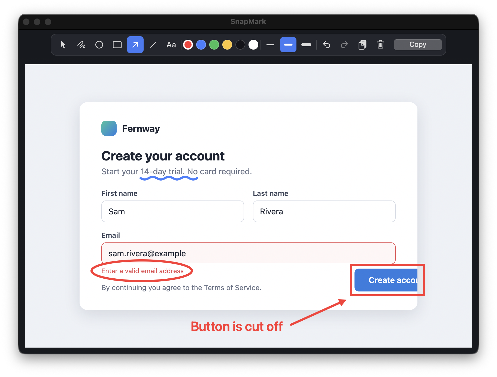
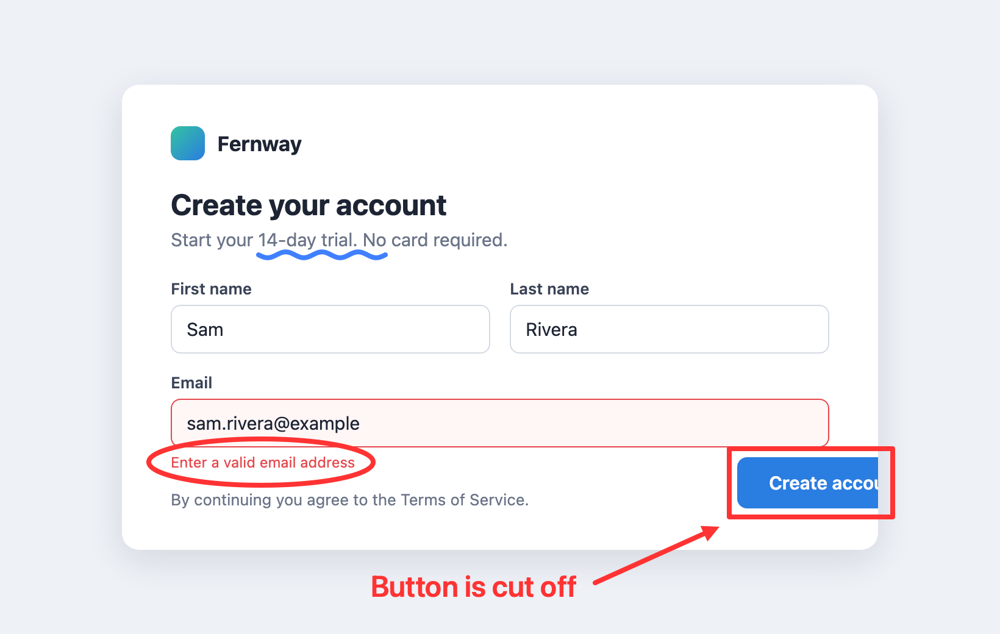

# SnapMark

A small native macOS tool for marking up screenshots. Take a screenshot to the
clipboard, press `Cmd+Shift+A`, and SnapMark comes up with the image already pasted.
Draw arrows, boxes, ellipses, lines, freehand strokes, or text on it, press `Cmd+C`,
and paste the result into Slack, Discord, an issue, or a message. Nothing is written
to disk.

<p align="center">
  
</p>

What `Cmd+C` puts on the clipboard: the screenshot at its original size with the
annotations drawn in, and nothing around it.

<p align="center">
  
</p>

The app is Zig for the app logic and Core Graphics rendering, plus a single
Objective-C file for AppKit. There is no web view and no runtime besides the system
frameworks. The release executable is about 140 KB.

## Download

1. Download `SnapMark.dmg` from the
   [latest release](https://github.com/ayyan67/snapmark/releases/latest). It runs on
   macOS 13 or later, on Apple Silicon and Intel Macs.
2. Open the DMG and drag SnapMark into Applications.
3. The app is not notarized by Apple, so the first launch is blocked. Open it once,
   then go to System Settings → Privacy & Security and click "Open Anyway". Or, in
   Terminal:

   ```bash
   xattr -dr com.apple.quarantine /Applications/SnapMark.app
   ```

SnapMark needs no special permissions: the global hotkey and the clipboard work
without Accessibility or Screen Recording access.

## Features

- `Cmd+Shift+A` from anywhere, or a click on the menu bar icon, shows the window and
  pastes the clipboard image. Launching the app, reopening it, or switching back to
  it from another app also loads the newest clipboard image, if there is one.
- The window sizes itself to the screenshot, so it shows at its real on-screen size
  when there is room.
- Tools: select, pen, ellipse, rectangle, arrow, line, text (keys `1` to `7`).
- Hold Shift while dragging for a perfect circle or square.
- Select, move, and resize shapes; double-click text (or click it with the text tool)
  to edit it; Backspace deletes the selection, or the last shape.
- Six colours and three stroke widths.
- Undo and redo (`Cmd+Z`, `Cmd+Shift+Z`).
- `Cmd+C` copies the annotated image as a PNG at the screenshot's exact pixel size and
  DPI, with nothing around it.
- `Esc` or `Cmd+W` hides the window; SnapMark keeps running in the menu bar.
  `Cmd+Q` quits.

Annotations are stored in the image's pixel coordinates, so they stay attached to the
image when the window is resized, and stroke widths are chosen in screen points so a
4 pt line looks the same on a Retina or non-Retina screenshot.

Pasting the same clipboard again (or SnapMark's own copied output) is ignored, so it
never throws away your annotations. A new screenshot starts a fresh document.

## Build and install

Requires Zig 0.15.2 and the Xcode command line tools.

```bash
scripts/install.sh    # build, bundle, replace /Applications/SnapMark.app, launch
```

The pieces, if you want them separately:

```bash
scripts/build.sh      # zig-out/bin/snapmark
scripts/make_app.sh   # zig-out/SnapMark.app (ad-hoc signed)
scripts/make_dmg.sh   # zig-out/SnapMark.dmg
SNAPMARK_UNIVERSAL=1 scripts/build.sh   # arm64 + x86_64 binary, as in releases
scripts/selftest.sh   # clipboard round-trip check (replaces your clipboard)
```

`scripts/build.sh` calls `zig build-exe` directly. On macOS 26, Zig 0.15.2 cannot link
its own build runner against the macOS 26 SDK, so `zig build` fails there with
undefined `_abort`, `_bzero`, and similar. The script builds against a macOS 15 SDK
instead when the command line tools have one, which they do by default. `build.zig`
is kept for machines where `zig build` works.

To sign with a Developer ID instead of ad hoc:

```bash
export SNAPMARK_CODESIGN_IDENTITY="Developer ID Application: <Name> (<TeamID>)"
export SNAPMARK_CODESIGN_ENTITLEMENTS=/path/to/entitlements.plist   # optional
scripts/make_app.sh
```

## Layout

```
src/main.zig      entry point and the C-callable functions the shim uses
src/state.zig     document state: shapes, selection, undo history, background, view transform
src/shapes.zig    shape union (pen, ellipse, rect, arrow, line, text) with u64 ids
src/math.zig      bounds, hit-testing, move and resize, all in image pixel space
src/drawing.zig   Core Graphics rendering for the screen and for the clipboard export
src/shim.m        AppKit: window, toolbar, canvas view, menus, pasteboard, status item,
                  Carbon global hotkey, inline text editor, Core Text drawing
src/bridge.h      the C interface between the two
scripts/          build, bundle, install, DMG, self-test, benchmark, icon
docs/             README screenshots
bench/            launch-time and memory harness
```

## Performance notes

- The clipboard image is decoded once at full resolution. For display it is
  pre-scaled to the exact device-pixel size it is shown at and cached, so a redraw
  while drawing is a 1:1 blit. During a live window resize the cache is bypassed and
  rebuilt once the resize ends.
- Toolbar state is only touched when something it shows changes, not on every
  mouse-drag event.
- Text is drawn with Core Text rather than AppKit string drawing.
- The menu bar item, global hotkey, and main menu are set up after the first frame.

## Measurements

Launch to window on screen, median of 15 interleaved runs. Apple M3 Pro, macOS 26.6,
nothing on the clipboard, measured with `bench/launchbench.swift`.

| | Launch to window | Physical footprint |
|---|---|---|
| SnapMark (this version) | 150 ms | 37 MB |
| Earlier Zig prototype | 138 ms | 37 MB |
| Earlier Tauri version | 202 ms | not measured; RSS was 208 MB including 3 WebKit processes |

The Tauri row comes from the earlier README and was measured on a quieter machine. The
prototype had text-label buttons and no empty-state text. The extra 12 ms here is
mostly loading SF Symbols and the system font for the toolbar icons and hint.

Resident memory (RSS) reads about 100 MB for this version against 77 MB for the
prototype. The difference is shared, read-only font and symbol pages, and the
physical footprint (`footprint -p <pid>`) is the same for both.

To reproduce:

```bash
swiftc -O bench/launchbench.swift -o /tmp/launchbench
/tmp/launchbench zig-out/bin/snapmark 11 3
```
